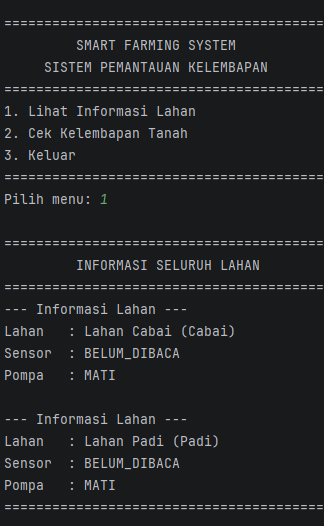
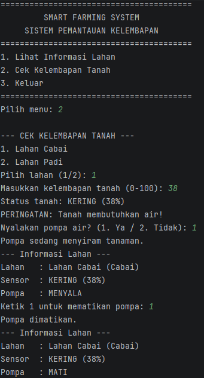
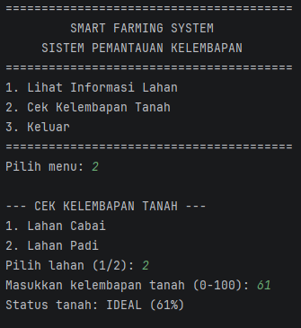

# SMART FARMING SYSTEM
## Sistem Pemantauan Kelembapan Tanah Berbasis IoT (Simulasi CLI)
---
## 1. Identitas Mahasiswa & Tema NIM
**Nama Lengkap** : Eko Rahmat Tulus <br>
**NIM** : H1D025064 <br>
**Tema Responsi** : **Internet of Things (IoT) - Smart Farming System** <br> 
**Keterangan Tema** : Sistem simulasi pemantauan kelembapan tanah pada lahan pertanian dan pengendalian aktuator pompa air berdasarkan pembagian nomor digit NIM. 
---
## 2. Petunjuk Compile dan Run Melalui Terminal
Aplikasi ini dibangun menggunakan bahasa pemrograman **Java** tanpa ketergantungan pustaka luar (hanya menggunakan pustaka bawaan Java Standard Edition / Java SE).
### Prasyarat
Pastikan Java Development Kit (JDK) versi 8 atau yang lebih baru telah terpasang pada komputer Anda. Periksa instalasi dengan perintah:
```bash
javac -version
java -version
```

### Langkah-Langkah Menjalankan Program
Buka terminal (Command Prompt / PowerShell di Windows, atau Terminal di macOS/Linux) dan arahkan ke direktori root proyek ini (`Responsi`):

#### 1. Kompilasi (Compile)
Kompilasi seluruh berkas Java yang berada di dalam direktori `src/` dan simpan hasil *bytecode* (`.class`) ke dalam folder `bin/`:
**Windows (PowerShell / Command Prompt):**
```powershell
javac -d bin src/*.java
```

**macOS / Linux:**
```bash
javac -d bin src/*.java
```

#### 2. Menjalankan Program (Run)
Jalankan program utama dari class `Main` yang telah dikompilasi:
```bash
java -cp bin Main
```

#### Alternatif: Perintah Sekali Jalan (Compile & Run)
**Windows PowerShell:**
```powershell
javac -d bin src/*.java; java -cp bin Main
```

**Linux / macOS / Git Bash:**
```bash
javac -d bin src/*.java && java -cp bin Main
```

---
## 3. Screenshot & Luaran Program
Berikut adalah dokumentasi tangkapan layar (*screenshot*) dan representasi luaran (*output*) antarmuka CLI pada setiap alur program:
---

### A. Menu 1 — Lihat Informasi Lahan
Menampilkan daftar seluruh lahan tanam awal beserta tanaman, sensor kelembapan, dan pompa air yang terpasang pada masing-masing lahan: <br>
> 

---

### B. Menu 2 — Cek Kelembapan Tanah (Skenario Tanah KERING & Kontrol Pompa Air)
> 
<br>Alur ketika kelembapan tanah di bawah batas kritis (`KERING`):
1. Pengguna memilih lahan (misal: Lahan Cabai).
2. Pengguna memasukkan nilai kelembapan (misal: `25%` di mana batas kritis cabai adalah `40%`).
3. Sistem mendeteksi status tanah `KERING` dan menampilkan **PERINGATAN**.
4. Sistem menawarkan opsi untuk menyalakan pompa air (`1. Ya / 2. Tidak`).
5. Jika pengguna memilih `1` (Ya):
   - Pompa aktif menyiram tanaman.
   - Status pompa pada informasi lahan diperbarui menjadi `MENYALA`.
   - Sistem meminta pengguna mengetik `1` untuk mematikan pompa air.
   - Pompa dimatikan dan status diperbarui menjadi `MATI`.
     
---

### C. Menu 2 — Cek Kelembapan Tanah (Skenario Tanah IDEAL)
> 
<br>Alur ketika kelembapan tanah berada di atas atau sama dengan batas kritis:
- Sistem melaporkan status `IDEAL`.
- Sistem tidak menampilkan peringatan dan tidak memicu penawaran penyiraman darurat, lalu langsung kembali ke menu utama.

---

